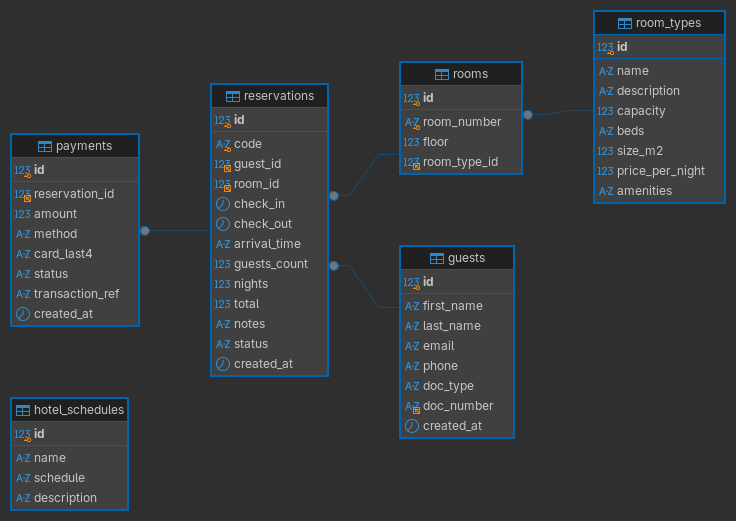

# Hotel JW Marriott · Sistema de reservas

Proyecto académico (React + Node/Express + MySQL) para practicar control de versiones con Git y GitHub.
Flujo público para un **usuario invitado**: landing → datos → fechas/horario → habitación → resumen → pasarela de pago *mock* → e-ticket en PDF.

## Requisitos
- Node.js 18.11+
- MySQL 8 corriendo en local (usuario `root` sin contraseña por defecto)

## Puesta en marcha
```bash
npm run install:all   # instala dependencias (raíz, backend y frontend)
npm run db:init       # crea la BD hotel_jw_marriott con habitaciones y horarios de ejemplo
npm run dev           # API en :4000 y web en http://localhost:5173
```
Si tu MySQL tiene otra contraseña/usuario: `cp backend/.env.example backend/.env` y edítalo.

> `db:init` recrea las tablas desde cero (borra reservas existentes).

## Estructura (pensada para repartir ramas por módulo)
```
database/schema.sql              Esquema + datos semilla
backend/src/routes/              info.js (habitaciones, horarios, disponibilidad) · reservations.js
backend/src/services/            reservationService.js (lógica) · ticketPdf.js (e-ticket)
backend/src/utils/validate.js    Validaciones
frontend/src/pages/              Landing · Booking · Payment · Confirmation
frontend/src/api.js              Cliente HTTP
```

## 🗄️ Modelo de Base de Datos (Esquema Entidad-Relación)

El sistema utiliza una base de datos relacional orientada a la gestión hotelera, estructurada en torno a 6 entidades clave:

### Entidades Principales

### 📊 Entidades Principales

* **`room_types`**: Define las categorías o tipos de habitaciones disponibles (ej. Single, Double, Deluxe King). Almacena información descriptiva como capacidad (`capacity`), tipo de camas (`beds`), tamaño (`size_m2`), precio por noche (`price_per_night`), comodidades (`amenities`) y la ruta de la imagen (`image_url`).
* **`rooms`**: Representa las habitaciones físicas del hotel. Contiene el número de habitación (`room_number`) y el piso (`floor`), vinculándose directamente con su categoría (`room_type_id`).
* **`guests`**: Almacena la información de los huéspedes o clientes (nombre, apellido, correo electrónico, teléfono, tipo y número de documento de identidad).
* **`reservations`**: Es la entidad central del sistema que gestiona el proceso de reserva. Registra el código único de reserva (`code`), las fechas de `check_in` y `check_out`, la hora estimada de llegada, cantidad de huéspedes, noches de estadía, el monto total (`total`), notas adicionales y el estado de la reserva (`status`).
* **`payments`**: Gestiona las transacciones financieras asociadas a las reservas. Guarda el monto abonado (`amount`), el método de pago (`method`), los últimos 4 dígitos de la tarjeta (`card_last4`), la referencia de la transacción y el estado del pago (`status`).
* **`hotel_schedules`**: Tabla independiente orientada a almacenar la información informativa y de servicios generales del hotel, como los horarios de atención y sus descripciones.

---

### 🔗 Relaciones del Sistema

1. **`room_types` → `rooms` (1 a N):**
   * Un tipo de habitación puede estar asignado a varias habitaciones físicas. Cada habitación física pertenece a un único tipo de habitación (`rooms.room_type_id` → `room_types.id`).

2. **`guests` → `reservations` (1 a N):**
   * Un huésped puede realizar múltiples reservas a lo largo del tiempo. Cada reserva pertenece obligatoriamente a un único huésped (`reservations.guest_id` → `guests.id`).

3. **`rooms` → `reservations` (1 a N):**
   * Una habitación física puede ser reservada en distintas fechas. Cada reserva asigna una única habitación específica (`reservations.room_id` → `rooms.id`).

4. **`reservations` → `payments` (1 a N):**
   * Una reserva puede registrar uno o varios pagos o intentos de pago. Cada pago está vinculado directamente a una única reserva (`payments.reservation_id` → `reservations.id`).



## API
| Método | Ruta | Descripción |
|---|---|---|
| GET | `/api/room-types` | Tipos de habitación |
| GET | `/api/hotel-info` | Horarios y servicios |
| GET | `/api/availability?checkIn&checkOut&guests` | Disponibilidad por tipo |
| POST | `/api/reservations` | Crea reserva (PENDING, 15 min de bloqueo) |
| GET | `/api/reservations/:code` | Consulta reserva |
| POST | `/api/reservations/:code/pay` | Pago mock → CONFIRMED |
| GET | `/api/reservations/:code/ticket` | E-ticket PDF (solo pagadas) |

## Pasarela de prueba
- Tarjeta válida: `4111 1111 1111 1111`, vence `12/30`, CVV `123` (botón "Usar tarjeta de prueba").
- Cualquier tarjeta que termine en `0002` simula un pago rechazado.
- Solo se guardan los últimos 4 dígitos.

## Ideas para sus ramas
`feature/modulo-habitaciones`, `feature/modulo-reservas`, `feature/modulo-pagos`, `feature/huespedes`, `release/v1.0`.
b